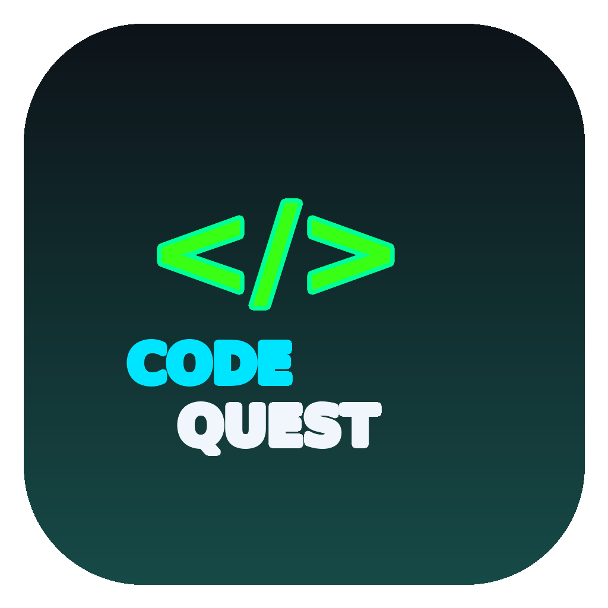

# 🎮 Code Quest — لعبة ألغاز برمجية (بايثون)

لعبة أسئلة وألغاز **برمجية فقط بلغة بايثون** بتصميم يشبه محرر الأكواد الداكن مع إضاءة نيون.



## ✨ المميزات
- 🔹 20 سؤالاً برمجياً بحت (بايثون فقط): مفاهيم، Output، أخطاء شائعة
- 🔹 مؤقت 30 ثانية لكل سؤار + نقاط وإحصائيات
- 🔹 تصميم Code Editor داكن مع إضاءة Neon أخضر/سماوي
- 🔹 حفظ أفضل نتيجة تلقائياً
- 🔹 لغة الواجهة: العربية (الأسئلة تقنية بالمصطلح الأصلي)

## 🚀 كيف أحصل على ملف APK؟
أسهل طريقة (بدون تثبيت شيء على جهازك):

1. أنشئ مستودعاً جديداً على GitHub وارفع هذه الملفات إليه
2. اذهب إلى تبويب **Actions** → ستجد workflow باسم **Build APK** يعمل تلقائياً
3. بعد ~20-30 دقيقة، حمّل ملف APK من قسم **Artifacts** (اسمه `codequest-apk`)
4. انسخ APK إلى هاتفك وثبّته (فعّل تثبيت التطبيقات من مصادر غير معروفة)

## 🛠️ البناء المحلي (اختياري)
```bash
sudo apt install openjdk-17-jdk unzip
pip install --user buildozer cython==0.29.36
buildozer android debug   # يُنتج bin/codequest-1.0-arm64-v8a-debug.apk
```

## 🐍 التقنيات
Kivy + Python 3 — بناء APK عبر Buildozer/p4a، وبناء تلقائي عبر GitHub Actions.

## 📝 الترخيص
MIT — حر الاستخدام والتعديل.
